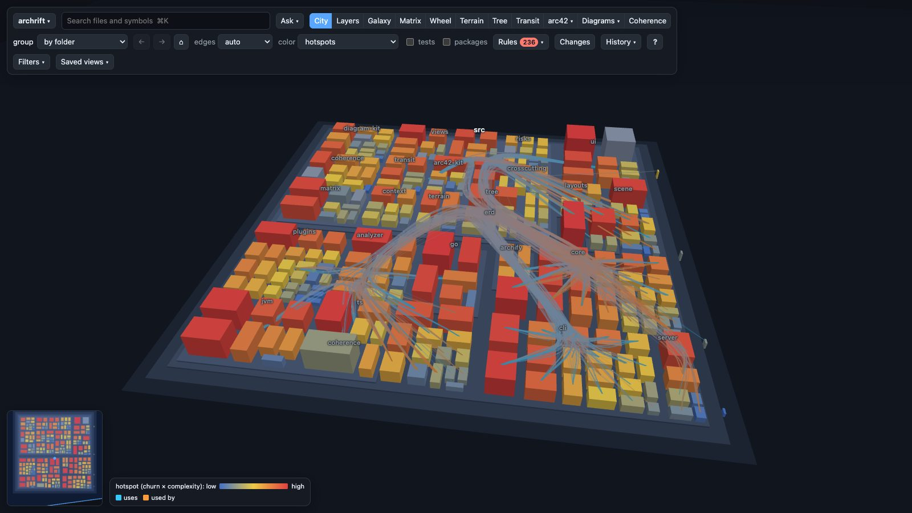
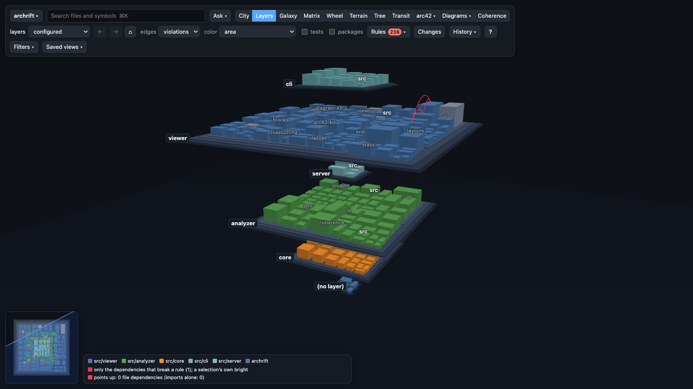
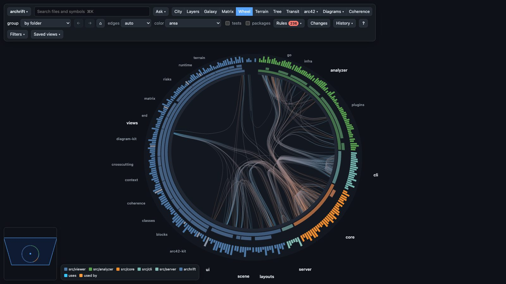
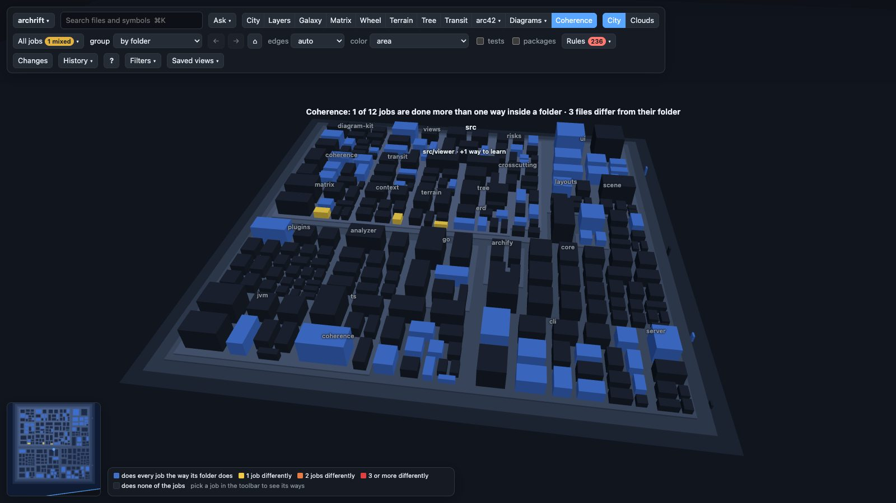
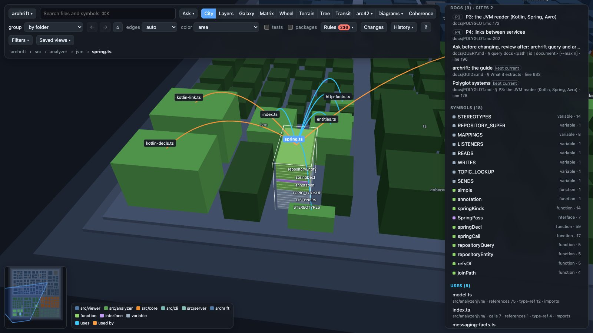
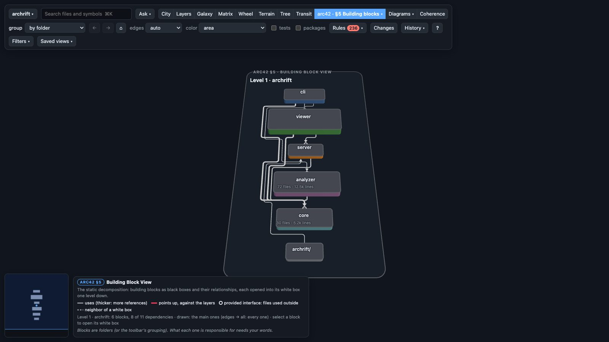

# archrift

> **See how your codebase is built, and keep it that way while you and your agents change it.**


[Why](#why-archrift) · [Compared](#archrift-graphify-floorplan-or-archify) · [Features](#features) · [See it in action](#see-it-in-action) · [Install](#install) · [Quick start](#quick-start) · [For coding agents](#for-coding-agents) · [How it works](#how-it-works) · [Docs](#documentation) · [FAQ](#faq) · [Contributing](#contributing) · [Credits](#credits)



<sub>archrift's own repository, about 400 files, as a city: folders are districts, files are buildings, height is size. Color it by hotspot, and red marks the files that changed a lot lately and are complex.</sub>

## Why archrift?

Code gets written faster than anyone can read it, more and more by coding
agents. Each change is locally right. But a page starts importing the
server, a second way to call the backend creeps in, one import drags dozens
of files into every page. No single diff shows it, and nobody draws the
diagram that would.

archrift draws it from the code itself, keeps drawing it as the code changes,
and checks it:

- **For people:** a 3D map of the codebase in nine views, the arc42 sections
  drawn from the analysis, and diagrams (tables, classes). You can go back
  through its history and get answers to questions in plain words.
- **For coding agents:** answers *before* a change ("how does this folder
  call the server?", "may I import that?", "what breaks if I change this?")
  and a review *after* it ("what did this change do to the architecture?"),
  in about two seconds, from the working tree, uncommitted edits included.
- **For reviews and CI:** architecture rules that fail the build, and a diff
  of the architecture for a pull request.

The analysis uses the TypeScript compiler, tree-sitter and git. No LLM is
involved, so the same code always gives the same map.

## archrift, Graphify, Floorplan or archify?

We looked closely at these three while building archrift, and took ideas
from each ([Credits](#credits)). They answer different questions:

| | **archrift** | [Graphify](https://github.com/Graphify-Labs/graphify) | [Floorplan](https://github.com/haydenschmitty/floorplan) | [archify](https://github.com/tt-a1i/archify) |
|---|---|---|---|---|
| **The question it answers** | "How is this codebase built, does it keep its own rules, and what did this change do to it?" | "What does my agent need to know without reading every file?" | "How does the app I built actually work, and what should I worry about?" | "How do I show this system clearly?" |
| **Made for** | Developers and their coding agents, people reviewing changes, and teams keeping an architecture | Coding agents (memory and fewer tokens) | People who build with AI and don't read the code | Anyone explaining a system |
| **How it reads code** | The TypeScript compiler with its type checker, plus framework plugins (Next.js, React, tRPC, Prisma, Dexie, Angular, NgRx, Spring); tree-sitter for Kotlin, Go and Avro | tree-sitter for ~40 languages, guessing calls by name; an LLM for docs, PDFs and media | Scripts for the mechanics; the AI names and describes the parts | The agent writes diagram JSON by hand; archify renders it |
| **What you get** | A 3D map in nine views, arc42 sections, ERD and class diagrams, rules, coherence, hotspots, `query`, `diff` | A knowledge graph (`graph.json`), a report, an HTML graph, a wiki, an MCP server | A zoomable map of parts, endpoints, screens and cross-repo requests | Polished diagrams in 10 types, with image and video export |
| **Checks the architecture** | Yes: rules (layers, forbidden and required reach, cycles, limits) that fail CI; `diff` gates a change | No | A health check for common AI-app mistakes | No |
| **Only here** | Coherence (jobs done several ways), Reach (what an import brings into pages), CRAP, time travel, links from docs and decisions to code | Docs, papers and video in the graph, ~40 languages, a PR dashboard | Plain-English names everywhere, blueprints from a PRD | 10 diagram types, image and video export |
| **Runs in** | Your terminal and browser; any agent that can run a command; an optional Claude Code hook | 20+ assistants (skill, hook, MCP) | Claude Code, Codex | Claude Code, Codex and others |

**Rule of thumb:** to explain a system, use archify. To give an agent a
memory of a large polyglot codebase, use Graphify. To understand an app you
built with AI without reading code, use Floorplan. To see how a TypeScript,
Kotlin or Go codebase is built and keep it from drifting, use archrift. They
also work together: `archrift export archify` writes archify's JSON from
archrift's analysis.

## Features

- 🏙️ **Nine ways to see it.** City, Layers, Galaxy, Matrix, Wheel, Terrain,
  Tree, Transit and Coherence. Every box is animated to its new place, and a
  link reopens the same view.
- 📐 **arc42 and diagrams, drawn from the code.**
  - The context (§3), the building blocks (§5), runtime scenarios that follow
    a page down to its tables (§6), the cross-cutting concepts (§8), the
    risks (§11).
  - An ERD for every schema it finds (Prisma, Dexie, SQL migrations, JPA,
    Mongo) and class diagrams.
- 🚦 **Rules that fail the build** ([guide](docs/GUIDE.md#check-architecture-rules)).
  - Layers, forbidden imports, forbidden reach (even through other files),
    required reach ("every API route reaches the auth check"), import
    cycles, size and complexity limits.
  - `check` exits 1, and a rule that matches nothing counts as broken.
- 🧭 **Coherence.** How many ways the code does each job (HTTP calls, dates,
  state, validation, test doubles …), which files stray from their folder's
  way, and the way to follow.
- 🔥 **History.**
  - Hotspots (churn × complexity).
  - Files that change together without depending on each other: hidden
    coupling.
  - A timeline that grows and shrinks the city commit by commit.
- 🤖 **Asked before a change, reviewed after.**
  - `query ways | rules | impact | docs | file | crap | path` answers an
    agent's questions.
  - `diff` reports what the change did: rules broken or fixed, new cycles,
    new ways of doing a job, files an import brings into pages, documents it
    may have outdated. It exits 1 on a new error.
- 📚 **Docs and decisions, linked to the code** ([guide](docs/GUIDE.md#docs-and-decisions)).
  Which architecture pages, specs and records name a file. Where the
  decision a comment cites (`ADR-12`, `D7`) is written down. Which documents
  a change may have outdated.
- 💬 **Ask the map.** A question in plain words, answered by Claude Code on
  your machine, read-only. The answer lights up on the map, as a numbered
  walkthrough when it's a sequence.
- 🟢 **Changes.**
  - The change in progress lit on the map, with what the diff finds in each
    file and the coding agent's notes on why it changed.
  - Or the last commit, or everything since one.
- 🌐 **Systems of services.** TypeScript beside Kotlin (Spring), Go and Avro,
  with HTTP calls, Kafka topics and databases linked across the services.
- ⚡ **Live and local.**
  - `--watch` updates the open map within a second of saving.
  - Everything runs on `127.0.0.1`.
  - `export html` writes the whole viewer and graph into one file that opens
    offline.

Also:
- `init`: a first look at a project archrift hasn't seen. It writes a starter
  config and a report with the bridge files and the questions worth asking.
- `describe`: names and one-line descriptions, kept beside the config,
  marked stale when the code's exports change.
- An optional Claude Code hook ([guide](docs/GUIDE.md#a-hook-for-claude-code-optional)).
- Search (`⌘K`), Focus and Impact, a path finder, saved views, and a
  keyboard cheat sheet (`?`).

## See it in action

The pictures show archrift's own repository.

**Layers.** One plane per architecture layer, here the five in archrift's
config: cli, viewer, server, analyzer and core, top to bottom.
Dependencies that point up are red, and the legend counts them.



**Wheel.** Files on a ring by folder, dependencies bundled through the
middle: the quickest picture of what's tangled with what.



**Coherence clouds.** One cloud per job done several ways. Colors gathered
in lobes means coherent; speckled means mixed. In archrift's viewer, shared
state is one such job: mostly Zustand, with a few files on an external store.



**A file's docs and decisions.** The documents naming a file, those kept
current first, and the decision ids its comments cite, with where each is
defined.



**arc42 §5, drawn from the code.** The building blocks and how they depend
on each other: for archrift, `src/analyzer`, `src/cli`, `src/core`,
`src/server` and `src/viewer`. Click a block to open its white box.



## Install

Prerequisites:
- Node.js 22.18 or newer.
- git.
- For the Ask bar and the hook: the Claude Code CLI.

```bash
npm i -g archrift          # the archrift command
npx archrift <command>     # or run it without installing
```

The package runs no install scripts.

To pin the version a project's CI uses, add it to the project:

```bash
npm i -D archrift
npx archrift check
```

From a checkout:

```bash
git clone https://github.com/codingarchitect-wq/archrift
cd archrift
npm install && npm run build   # the viewer into dist/, the command line into lib/
npm link                       # the archrift command, from this checkout
```

A linked checkout runs its TypeScript source directly, so an edit counts at
the next call.

### Upgrade

`npm i -g archrift@latest`, or `git pull` in a linked checkout.
`archrift --version` prints the version.

A project can name the lowest version it needs in `.archrift/config.json`:

```json
{ "requires": ">=0.2" }
```

An older archrift then stops with a message saying how to update, instead
of answering wrongly. [CHANGELOG.md](CHANGELOG.md) says what changed and how
to move.

## Quick start

In your project:

```bash
npx archrift init                     # a first look: detects the stack, writes .archrift/config.json, reports
npx archrift serve . --watch --open   # the 3D viewer at http://127.0.0.1:4300
```

The rest of this README writes `archrift`; put `npx` in front where it
isn't installed globally. Then, from inside the project:

```bash
archrift check                        # every rule, every case that breaks it; exits 1 on an error
archrift query file <path>            # one file at a glance
archrift diff                         # what your uncommitted change does to the architecture
```

### Things to try

The paths below are archrift's own. Clone it and run them there, or put in
paths of your project.

| In the terminal | In the viewer |
|---|---|
| `archrift query ways src/viewer/ui --job "shared state"` | **Wheel**, then hover a folder's band |
| `archrift query rules src/server/api.ts --to src/viewer/colors.ts` | **Rules**, then click a violation |
| `archrift query impact src/core/model.ts` | Select a file, then **Impact** |
| `archrift query docs docs/GUIDE.md` | Select a file and read its **Docs** section |
| `archrift coherence` | **Coherence**, then **Clouds** |
| `archrift export html --source` | **Ask**: "How does a saved file reach the open map?" |

## For coding agents

`archrift init` prints the lines to add to the project's `CLAUDE.md` or
`AGENTS.md` ([docs/QUERY.md](docs/QUERY.md#for-agents-what-to-put-in-claudemd-or-agentsmd)).
The commands in them, like the hook's notes, use the command you started
archrift with: `archrift`, `npx archrift` or `node <path>/src/cli/main.ts`.

The agent then asks before it writes. On archrift's own code:

```
$ archrift query ways src/viewer/ui/NewPanel.tsx --job "shared state"
src/viewer/ui/NewPanel.tsx (no file yet; it would be in block src/viewer)

JS · Shared state (state several components share): done several ways
  src/viewer: Zustand 27 · external store (useSyncExternalStore) 3 → use Zustand, as src/viewer/ui/App.tsx, src/viewer/ui/Ask.tsx, src/viewer/ui/Help.tsx do
  whole project: Zustand 27 · external store (useSyncExternalStore) 3

$ archrift query impact src/core/model.ts --max 3
src/core/model.ts: 285 files depend on it (187 directly), 19 entry points
  212 production files, 73 test files (71 to run); by steps 1: 187 · 2: 88 · 3: 10

Directly (187):
  src/analyzer/analyze.ts:5  (imports, references, type-ref)
  src/analyzer/assemble.ts:11  (imports, references, type-ref)
  src/analyzer/coherence/paradigms.ts:9  (imports, references, type-ref)
  … 184 more (--max)
…
Entry points reached (19):
  src/analyzer/analyze.worker.ts
  src/cli/main.ts
  src/viewer/layouts/galaxy.worker.ts
  … 16 more (--max)

Tests that reach it (run these, 71):
  …
```

It also reviews its own change before it finishes. Here a new file in
archrift's server imports the viewer's palette and calls a URL with axios
(a scratch change, made for this example):

```
$ archrift diff
archrift diff archrift: HEAD (11d3ba8b) → the working tree, 1 file touched (1 new, 0 removed)

Rules: 2 new violations
  ✗ layers-point-down (error): src/server/theme.ts → src/viewer/colors.ts
  ✗ node-side-without-viewer (error): src/server/theme.ts → src/viewer/colors.ts

Coherence: 1 new way
  JS · HTTP calls: new way axios

Blocks: 1 new dependency between blocks
  src/server → src/viewer, through src/server/theme.ts → src/viewer/colors.ts
```

It exits 1 there: the change breaks two error rules.

Agents don't have to remember to ask. `archrift hook install` adds an
optional Claude Code hook that hands the agent a file's rules and its
folder's ways the first time it writes to the file. It is off until you
install it, and `archrift hook uninstall` removes it
([guide](docs/GUIDE.md#a-hook-for-claude-code-optional)).

## How it works

```mermaid
flowchart LR
  code["Your code<br/>+ git history<br/>+ docs"] --> analyze["Analyze<br/>TypeScript compiler · tree-sitter<br/>framework plugins"]
  analyze --> graph[(".archrift/graph.json<br/>cached per file")]
  graph --> viewer["Viewer<br/>127.0.0.1:4300"]
  graph --> cli["check · query · diff<br/>coherence · init"]
  graph --> export["export html<br/>export archify"]
  viewer -. "--watch: only what changed" .-> analyze
```

- **The analysis** turns files, symbols and their references into one graph.
  Each file's part is cached by content. On archrift's own repository
  (about 400 files) a cold run takes about 9 seconds on a laptop and a warm
  one about 2. With `--watch` a saved file shows on the map within about a
  second.
- **Plugins** add the links imports can't show: tRPC calls to their
  procedures, Prisma and Dexie queries to their tables, Next.js and Angular
  routes, React context, Spring handlers, HTTP calls matched to the handlers
  serving them, Kafka topics, schemas.
- **Everything else** reads that graph: the viewer, the rules, coherence,
  `query`, `diff` and the exports.
- **The only LLM** is the Ask bar's: Claude Code on your machine, on your
  sign-in, allowed only to read.

**Languages:** TypeScript and JavaScript (with types), Kotlin, Go, Avro.
**Frameworks:** Next.js, React, tRPC, Prisma, Dexie, Angular, NgRx, Spring,
Pulumi. **Between services:** HTTP, Kafka, databases. The small projects in
[fixtures/](fixtures) exercise them (`fixtures/fullstack`,
`fixtures/angular`, `fixtures/kotlin-spring`, `fixtures/go-service` …).

## What it adds to your project

A `.archrift/` folder:
- **Committed:** the config and the descriptions (`descriptions.json`).
- **Ignored by git** (the `.gitignore` that `init` writes into it): the
  graph, the cache, snapshots, saved views, `init`'s reports, and the
  agent's `changes.json` notes.

A `.archviz/` folder, from archrift's former name, is still read when there
is no `.archrift/`.

archrift never changes your code. `hook install` writes to
`.claude/settings.local.json`, but only when you run it.

Outside the project, archrift keeps its home folder, `~/.config/archrift/`
(`$XDG_CONFIG_HOME/archrift`; `ARCHRIFT_HOME` moves it):
- `projects.json`: the projects the viewer switches between.
- `projects/<name>/`: the graph, cache, snapshots and saved views of a
  project without a `.archrift/` of its own. For a repository you can't or
  don't want to write into, keep its config there too
  (`projects/<name>/config.json`).

## Privacy

- The analysis, the server and the viewer run on your machine. The server
  listens on `127.0.0.1` only.
- No telemetry, no accounts, no network calls of its own.
- What archrift stores stays in the project's `.archrift/` and in its home
  folder, `~/.config/archrift/` (the project list holds local paths).
- `export html` leaves the source out unless you pass `--source`, and never
  includes local paths.
- The Ask bar runs your own `claude` CLI with Read, Grep, Glob and
  `archrift query` only. Environment files, keys, certificates and
  credentials are denied to it.

## Documentation

- [docs/GUIDE.md](docs/GUIDE.md): everything, command by command and view by view (the config, what it extracts, known limits, development)
- [docs/QUERY.md](docs/QUERY.md): `query` and `diff`, for agents and reviews
- [docs/COHERENCE.md](docs/COHERENCE.md): how many ways the code does each job
- [docs/POLYGLOT.md](docs/POLYGLOT.md): Kotlin, Go, Avro and the links between services
- [docs/ARC42-GENERIC.md](docs/ARC42-GENERIC.md): the arc42 views on any project
- [src/viewer/views/README.md](src/viewer/views/README.md): adding a view
- [CHANGELOG.md](CHANGELOG.md): what changed in each version, and how to move

## FAQ

**Does it need an LLM or an API key?** No. Only the optional Ask bar uses
one: your own Claude Code CLI.

**Which languages?** TypeScript and JavaScript through the compiler, Kotlin,
Go and Avro through tree-sitter. Other files show as assets. Python, Java
sources and Rust aren't read.

**How large a codebase?** On archrift's own repository (about 400 files) a
cold analysis takes about 9 seconds and a warm one about 2. On a generated
10,000-file repository, live updates take about 10 seconds; incremental
assembly is the open item.

**Will it change or commit my files?** No. It writes its own `.archrift/`
folder. `init` prints the lines for `CLAUDE.md` and never edits it.

**Can I fail CI on it?** Yes. `archrift check` exits 1 when a rule with
severity `error` is broken. `archrift diff` exits 1 on a new error, or one
the change makes worse. `--format markdown` writes a pull-request comment;
`check --format json` and `diff --format json` carry `schemaVersion: 1`.
Add archrift as a devDependency to pin its version (`npm i -D archrift`,
then `npx archrift check`).

**Monorepos and several services?** Yes:
- `mounts` analyze other folders with the root;
- `groups` group files by service or team;
- HTTP calls, Kafka topics and databases link the services
  ([docs/POLYGLOT.md](docs/POLYGLOT.md)).

**How is it different from Graphify, Floorplan or archify?** See
[the comparison](#archrift-graphify-floorplan-or-archify) and
[Credits](#credits).

## Contributing

Issues and pull requests are welcome on
[GitHub](https://github.com/codingarchitect-wq/archrift). Before a pull
request:

```bash
npm test             # unit tests (Vitest)
npm run typecheck
npm run test:e2e     # the viewer in a browser (Playwright)
npm run test:pack    # packs the package and runs the installed command in a scratch project
```

archrift checks itself: `archrift check` and `archrift diff` in the
checkout use its own `.archrift/config.json`.

## Credits

archrift borrows openly. These tools and ideas shaped it:

| From | What archrift took |
|---|---|
| [Graphify](https://github.com/Graphify-Labs/graphify) | Questions for agents (`query`) and a review mode (`diff`); links from docs and decisions to the code; `query impact`; bridge files and questions worth asking in `init`; the optional hook |
| [Floorplan](https://github.com/haydenschmitty/floorplan) | Words for the code (`describe`); Ask the map; the Changes panel with the agent's notes; `requireReach` rules |
| [archify](https://github.com/tt-a1i/archify) | The ERD and class views; the one-file HTML export; `export archify` |
| [ArchUnitTS](https://github.com/LukasNiessen/ArchUnitTS) | `limit` rules on measures; "a rule that matches nothing is broken" |
| [open-ontologies](https://github.com/fabio-rovai/open-ontologies) | Reach in `diff`: what one import brings into the pages |
| [ub-mode](https://github.com/unclebob/ub-mode) and [crapper](https://github.com/unclebob/crapper) | CRAP in `query crap`; complexity limits, and the diff's "grew" for a function past its limit |
| [Decoherence](https://maevyn.codes/decoherence) (essay) | Coherence: the jobs a codebase does several ways, and the clouds |
| [arc42](https://arc42.org) | The arc42 section views |
| Code cities, hotspots, hierarchical edge bundling | The City, churn × complexity, the Wheel |

## License

MIT. See [LICENSE](LICENSE).
